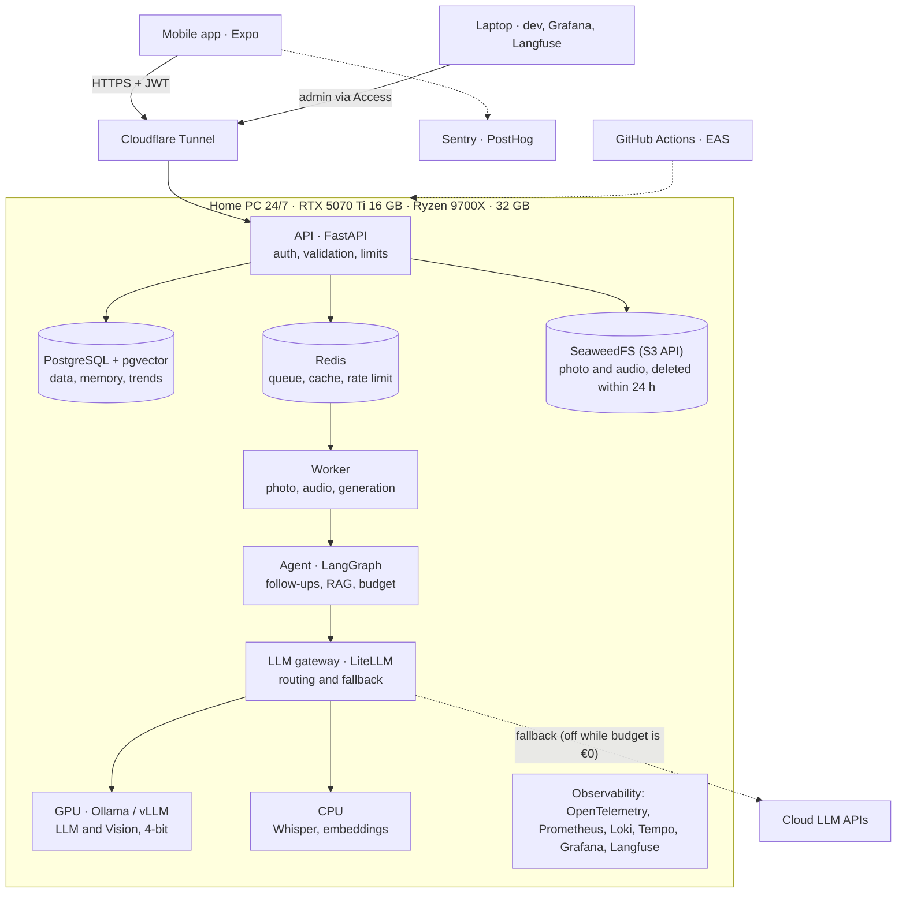
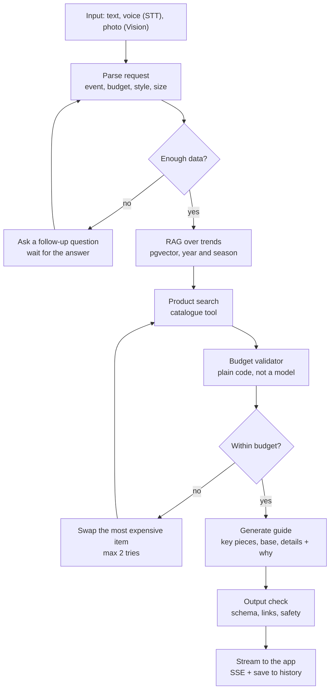

# Capsule (AI Style Consultant) — Project Blueprint

> **Implementation copy.** The project owner keeps the working version of this blueprint as a private doc. This file is the English version for implementation, current as of 2026-10-26.
>
> **Precedence:** an accepted ADR in `docs/adr/` and the root `CLAUDE.md` win over this file. Known differences from the owner's version: the Orchestrator is the main Claude Code session, not a subagent; Go is optional and needs a benchmark plus an ADR before use; accepted ADRs and owner decisions changed some choices (2026-10-26) — Python 3.13 (ADR-005), SAQ worker (ADR-006), SeaweedFS instead of MinIO with media deleted within 24 h and never backed up (ADR-008), MMKV-only mobile cache with SQLite deferred (ADR-003), no cloud LLM fallback while the budget is €0 (ADR-010), CI service containers instead of Testcontainers (ADR-016); guest first — sign-up after the first guide, so activation and time to first guide are measured from onboarding (E0-08, `docs/metrics.md`). When the owner's version changes, update this file in its own commit (`docs(blueprint): …`).

## 1. The problem we solve

People want to look good for a specific event, but lack the time, the trend knowledge and often the budget. Shops return a list of products; they do not explain **what matters most in a look and why**. Capsule is a personal stylist in the phone: it asks follow-up questions, understands photos and voice, stays within the budget (even €100) and answers with a prioritised guide.

**Target user (MVP):** men and women aged 20–60 in Europe who buy clothes online, have a limited budget and need quick advice for an event (date, business meeting, sport, yoga, meeting friends).

**Business model:** freemium (N free consultations per month) plus a subscription; affiliate links to shops later.

### Success metrics

Every technical decision must move at least one of these metrics.

| Metric | Meaning | MVP target | How we measure |
| --- | --- | --- | --- |
| Activation rate | New users who receive their first guide within 24 h of starting onboarding (guest first, no sign-up needed) | > 60% | First `guide_delivered` ÷ `onboarding_started` (see `docs/metrics.md`) |
| Time to first guide | Start of onboarding (after the consent choice) to first guide | p95 < 90 s | `since_onboarding_ms`, p50/p95 |
| Guide quality score | Eval score (LLM-as-judge + rules) | > 4.0 / 5 | Eval in CI |
| Budget compliance | Guides whose outfit total ≤ budget | 100% | Checked by code, not by a model |
| Helpful rate | Guides rated "helpful" | > 70% | 👍 / 👎 in the app |
| D7 retention | Users back after 7 days | > 20% | Cohort analytics |
| Click-through | Product opened from a guide | > 15% | `product_click` event |
| Sign-up conversion | Guests who create an account within 7 days of their first guide | Baseline first; target after 4 weeks of beta | `signup_completed` ÷ first `guide_delivered` |

**Out of MVP scope:** own marketplace, in-app payment, virtual try-on, web version.

## 2. Principles

These seven principles filter every task, ADR and code review. A decision that breaks a principle is recorded in an ADR with the reason.

| Principle | What it means here |
| --- | --- |
| Business goal first | Every task links a metric from section 1 (or an engineering SLO). No metric, no task. |
| Security from day one | Auth, validation, secrets, rate limiting and photo deletion policy land in the first epics, not "later". |
| Measurability | A feature is not done without logs, metrics and an analytics event. |
| Automation | Linters, tests, evals and builds run in CI. A manual step is a task to automate. |
| Simplicity | Modular monolith on FastAPI plus a worker. No microservices in the MVP. Go only if a benchmark proves the need. |
| Maintainability | A README in every module, an ADR for every significant decision, readable code over clever code. |
| Predictability | Every task estimated, a demo at the end of every epic, the risk log updated weekly. |

## 3. Architecture

A modular monolith on the home PC server, reachable only through a tunnel. The key element is the LLM gateway: the agent calls models through one OpenAI-compatible interface, so replacing the local GPU with cloud providers is a config change.



A request from the phone goes through the tunnel to the API. Heavy work (photo, audio, generation) goes through the Redis queue to the worker, and the worker runs the agent. The agent reaches models only through the gateway: the local GPU for LLM and Vision, the CPU for Whisper and embeddings. Cloud fallback is off while the budget is €0, so a GPU outage returns "try again later" (ADR-010). The laptop is for development and dashboards, not a server.

## 4. Stack (lead's view)

The stack follows "boring, proven technology plus one flexible layer over the models". Every row with an ADR number gets its own record with alternatives. Check current versions and models before starting: they change every few months.

| Layer | Technology | Why | ADR |
| --- | --- | --- | --- |
| Mobile | Expo (React Native) + TypeScript strict, Expo Router | One codebase for iOS and Android, OTA updates, EAS Build | ADR-001 |
| Mobile: state and data | TanStack Query (server state + offline cache), Zustand (local state) | Caching, retry and sync out of the box | ADR-002 |
| Mobile: storage | expo-secure-store (Keychain/Keystore, this device only) for tokens, MMKV for the query cache; SQLite deferred | Tokens never in plain storage | ADR-003 |
| Mobile: quality | Sentry (crashes + performance), PostHog (analytics, feature flags) | Crash-free rate, flags, staged rollout | ADR-004 |
| API | Python 3.13, FastAPI, Pydantic v2, OpenAPI 3.1 as the contract | Async, generated contract and mobile types | ADR-005 |
| Background jobs | Redis + SAQ worker | Photo, audio and generation never block HTTP | ADR-006 |
| Database | PostgreSQL 16 + pgvector, Alembic migrations, SQLAlchemy 2 (async) | One database for data, memory and RAG; fewer moving parts | ADR-007 |
| Cache and limits | Redis | Response cache, rate limiting, queue | ADR-006 |
| File storage | SeaweedFS behind the S3 API; deletion within 24 h by our own job | Local = S3 in the cloud with no code change | ADR-008 |
| Agent orchestration | LangGraph | Explicit state graph, checkpoints, nodes easy to test | ADR-009 |
| LLM gateway | LiteLLM (OpenAI-compatible), routing config + fallback | Local → cloud by config change | ADR-010 |
| Inference (local) | Ollama first → vLLM after a benchmark | Simplicity first, throughput later | ADR-011 |
| Models | LLM 8–14B (4-bit), Vision-LLM 7–12B, faster-whisper, embedding model (bge-m3 or similar) | Fit in 16 GB VRAM; STT and embeddings on CPU | ADR-012 |
| Observability | OpenTelemetry → Grafana (Prometheus, Loki, Tempo), Langfuse for LLM traces, Sentry | Metrics, logs, traces and LLM quality in one place | ADR-013 |
| Secure access | Cloudflare Tunnel (no open ports), JWT + refresh tokens | The home server is never exposed | ADR-014 |
| Secrets | Local: SOPS or Docker secrets; cloud: Vault / Secret Manager | No secrets in Git | ADR-015 |
| Tests | pytest, Hypothesis, real Postgres/Redis as CI service containers; Jest + RNTL; Maestro (mobile E2E); k6 (load) | Unit → integration → E2E → load | ADR-016 |
| Eval | Own eval runner + LLM-as-judge, run in CI | Guide quality as a number | ADR-017 |
| Code quality | Ruff, mypy (strict), ESLint, Prettier, TypeScript strict, pre-commit, Conventional Commits | Standards enforced automatically | ADR-018 |
| CI/CD | GitHub Actions, EAS Build/Update, GHCR for images | Automated from PR to release | ADR-019 |
| Go (optional) | Only for a hot path proven by a benchmark (e.g. catalogue ingestion) | Simplicity over "beautiful" architecture | — |

## 5. Project structure

One monorepo: mobile, backend, infrastructure and agent rules live together, so any agent sees the contract and the rules without loading extra context. The backend is a modular monolith: modules are isolated but deploy together.

```
capsule/
├── CLAUDE.md                  # main rules for all agents (short, with links)
├── README.md                  # how to run in 5 minutes
├── .claude/
│   ├── agents/                # specialist agent definitions (section 7)
│   ├── skills/                # skills: how to do common tasks (section 8)
│   └── commands/              # slash commands: /task, /review, /adr
├── docs/
│   ├── blueprint.md           # this file
│   ├── adr/                   # ADR-001…ADR-0NN
│   ├── design/                # flows, specs, tokens, reference PNGs
│   ├── metrics.md             # product metrics and engineering SLOs
│   ├── security.md            # threat model, OWASP checklist, data policy (E1)
│   ├── runbooks/              # what to do when the GPU fails, the queue overflows, etc.
│   └── tasks/                 # epics and task cards
├── contracts/
│   └── openapi.yaml           # single source of truth for the API
├── apps/
│   ├── mobile/                # Expo app
│   │   ├── app/               # screens (Expo Router)
│   │   ├── features/          # chat, onboarding, guide, profile
│   │   ├── shared/            # UI kit, generated API client, storage
│   │   └── e2e/               # Maestro flows
│   └── api/                   # FastAPI
│       ├── modules/
│       │   ├── auth/          # users, tokens
│       │   ├── consultations/ # conversations, history, feedback
│       │   ├── media/         # photo/audio upload, validation, TTL
│       │   ├── catalog/       # product search, prices
│       │   ├── trends/        # trend base + RAG
│       │   └── agent/         # LangGraph graph, nodes, tools, prompts
│       ├── core/              # config, database, logging, security, telemetry
│       ├── workers/           # background jobs
│       ├── migrations/
│       └── tests/             # unit / integration / contract
├── ml/
│   ├── evals/                 # scenario dataset, runner, reports
│   ├── prompts/               # versioned prompts
│   └── benchmarks/            # local vs cloud, quantisation, latency
├── infra/
│   ├── compose/               # compose.base / .local-gpu / .cloud / .observability / .tunnel
│   ├── grafana/               # dashboards as code
│   └── k6/                    # load scenarios
└── .github/workflows/         # CI: lint, test, eval, build, release
```

**Backend dependency rule:** modules talk only through a module's public interface (its service) and never touch another module's tables. This keeps the option to split a module out later if the numbers demand it.

## 6. The agent inside the product (LangGraph)

The agent is an explicit graph of fixed nodes, not "one big prompt". Each step can be tested on its own, seen in a trace, and given its own model.



Follow-up questions return to request parsing; going over budget returns to product search. The guide is generated only from products that passed the code check.

**Rules for every node:**

- Input and output are Pydantic schemas; invalid model output → one retry, then the fallback model.
- A timeout per node and for the whole graph; state checkpointed in Postgres so the conversation resumes after a follow-up.
- Every model call is traced in Langfuse with node name, model, tokens and latency.
- Model routing: request parsing and follow-ups use a small fast model; guide generation uses the best local or cloud model.
- Photo analysis describes clothes, colours and silhouette; it never rates appearance or infers sensitive traits.

## 7. The development agent team

The project owner is the Product Owner. The Orchestrator is the tech lead: it owns product quality and does not write features itself. In Claude Code the Orchestrator is the main session, because subagents cannot start other agents. The implementers are mid-strong/senior specialists, each with its own area and a say only in it. The reviewer and QA are independent: they did not see the code being written, so the work does not grade itself.

| Agent | Role | Owns | Does not | Definition of Done |
| --- | --- | --- | --- | --- |
| **Orchestrator (Tech Lead)** | Lead, product quality | Splits epics into cards, writes acceptance criteria, assigns the agent, checks the link to a metric, accepts work | Write feature code; merge without green review and QA | A card closes only with review = approve, QA = pass, metrics and docs updated |
| **Product Analyst** | Business and metrics | User stories, success metric, analytics events, eval scenarios per feature | Choose technologies | Every story has a metric and an event |
| **Product Designer (UX/UI)** | How the product works and looks | User flows, wireframes, design system (tokens, components, light/dark theme), screen states, tone of guides, accessibility; inclusive design for men and women aged 20–60 | Write production code; change the API | A spec for every screen before development; design review of the implementation (matches spec, HIG/Material, accessibility) |
| **Mobile Engineer** | Expo / React Native | Screens from the designer's specs, offline, secure storage, performance, HIG/Material | Change OpenAPI without Backend; invent UI without a spec | 60 fps, no cold start regression, RNTL + Maestro tests, design review = approve |
| **Backend Engineer** | FastAPI, database, queues | Endpoints to contract, migrations, indexes, idempotency, retries, timeouts | Touch mobile or prompts | EXPLAIN for new queries, unit + integration tests, OpenAPI updated |
| **AI Engineer** | Agent, prompts, models | LangGraph graph, tools, trend RAG, LLM gateway, routing/fallback, VRAM budget | Change the database schema alone | Eval not below baseline, traces in Langfuse |
| **Platform / DevOps** | Infra and CI/CD | Docker Compose, CI, tunnel, backups, dashboards, alerts | Write business logic | `compose up` from scratch works; the dashboard shows the new metric |
| **Security Engineer** | Security | Threat model, OWASP checklist, prompt injection, photo privacy, store requirements | — | No critical findings; `security.md` updated |
| **Code Reviewer** | Independent review | Reviews every PR against the language checklist (section 9) | Fix code itself — comments only | Approve or a list of blockers |
| **QA Engineer** | Quality verification | Checks acceptance criteria, runs tests, evals, k6, writes a report with numbers | Change production code | Report: what was checked, numbers, bugs found |

**How they interact:** Orchestrator → (card + criteria) → implementer → PR → Code Reviewer and Security (when needed) → QA → Orchestrator accepts or returns it. The project owner sees a demo and numbers at the end of each epic.

**Senior level for an agent** comes from duties, not from the word "senior" in a prompt: the agent first reads the contract and ADRs, proposes a plan with risks, writes tests, explains trade-offs, and stops to ask when a task conflicts with an ADR.

### Design: an app for men and women aged 20–60

- **Neutral base, personal accent.** Brand, colours and illustrations are gender-neutral; personalisation comes from user choice, not from "pink" and "blue" versions of the app.
- **Onboarding without assumptions.** The user chooses which wardrobe to shop for (menswear, womenswear or unisex, or "skip for now"), style and sizes, and can change it at any time. Nothing is inferred about gender from a photo.
- **Content for both audiences.** Events, trends, example looks and eval scenarios cover menswear, womenswear and unisex equally.
- **Ages 20–60 means accessibility.** Dynamic Type and font scaling, WCAG AA contrast, touch targets ≥ 44 pt / 48 dp, clear labels rather than icons alone, voice input as an equal option.
- **Tone of the guide.** Confident, explains "why", never comments on bodies or appearance, no youth slang by default.
- **Validation.** The designer tests a prototype with at least 5 people of different genders and ages before a key screen is built; results go into the task card.

## 8. Agent harness: rules, skills, ADRs, context

The harness is the frame every agent works in: what it reads at start, which actions it may take, how it checks itself and how it hands work on. The goal is the same quality whatever the chat or session.

### Context layers (shortest to longest)

1. **Root CLAUDE.md (≤ ~150 lines)** — mission, principles, test commands, prohibitions, links to detailed docs. Always read.
2. **Module CLAUDE.md** (`apps/mobile`, `apps/api`, `ml`, `infra`) — rules for that part only. Read only when working there.
3. **Agent definition** (`.claude/agents/*.md`) — role, area, Definition of Done, allowed tools.
4. **Skills** (`.claude/skills/*`) — step-by-step instructions for common tasks. Loaded on demand.
5. **Task card** (`docs/tasks/…`) — goal, metric, acceptance criteria, files that may be touched.
6. **ADRs** — only those the card links.

### Rules (excerpt for CLAUDE.md)

- One task = one branch = one PR = one feature. Nothing "while I'm here".
- No overcoding: no abstraction, config or dependency the task does not need. A new dependency = an ADR.
- Plan first (3–7 steps + risks), then code. The Orchestrator approves the plan.
- Contract first: an API change starts in `contracts/openapi.yaml`.
- Tests in the same PR. No tests, no PR.
- No secrets, tokens or real personal data in code, logs or tests.
- Do not touch files outside the card's list; need more — ask the Orchestrator.
- A conflict with an ADR — stop and propose a new ADR, never work around it.
- At the end: a short report (what was done, how it was verified, numbers, risks), no code recap.

### Skills

| Skill | Purpose |
| --- | --- |
| `new-endpoint` | Contract → Pydantic schema → service → router → tests → mobile client update |
| `db-migration` | Alembic migration, index for the query, EXPLAIN ANALYZE before/after, rollback plan |
| `mobile-screen` | Screen per HIG/Material, loading/empty/error/offline states, accessibility, test |
| `agent-node` | New LangGraph node: input/output, timeout, fallback, trace, unit test on fixtures |
| `prompt-change` | Versioned prompt change, eval run, comparison with baseline |
| `eval-run` | Eval suite run, report with deltas |
| `load-test` | k6 scenario, p95/p99 targets, report |
| `security-check` | OWASP checklist, secrets, prompt injection, incoming files |
| `adr` | ADR template and rules |
| `release` | Version, changelog, EAS build, staged rollout, feature flag |

### ADR template

Each ADR is one file, one page at most: **Context** (the problem, the constraints) · **Decision** · **Options** (with why they lost) · **Consequences** (pros, cons, what we monitor) · **Status** (proposed / accepted / superseded by ADR-NNN). ADRs are never edited after acceptance — only superseded.

### Context hygiene

- One chat = one task or one epic. A new epic starts a new chat with a link to this document and the card.
- Agents read files narrowly (the module, the ADR they need), not the whole repository.
- Heavy search and analysis go to a subagent that returns only the conclusion.
- At the end of a session the Orchestrator updates the card: status, decisions, what is left. The next chat starts from the card, not from chat history.
- Logs, dumps and long test output go to files; only a summary enters the context.

## 9. Workflow and code review

Every feature takes the same path. Going back a step is a normal part of the process, not a failure.

### Task lifecycle

1. **Task card** (Orchestrator + Product Analyst): goal, metric, acceptance criteria, estimate (S ≤ 2 h, M ≤ 1 day; larger — split), allowed files.
2. **Plan** (implementer): steps, risks, which tests. The Orchestrator approves.
3. **Implementation** on branch `feat/<id>-<slug>`: code + tests + docs.
4. **Local checks**: pre-commit (linters, types, secret scanner), module tests.
5. **PR** from the template: what and why, how it was verified, numbers before/after, screenshots for UI.
6. **CI**: lint → typecheck → unit → integration → contract test (OpenAPI) → eval (if the agent changed) → image build.
7. **Independent review**: Code Reviewer (+ Security for auth, media, prompts). A blocker → back to step 3.
8. **QA**: acceptance criteria checked on the local stack, report with numbers. Fail → back to step 3.
9. **Merge** (squash, one commit on main) and update the card, CHANGELOG and metrics.
10. **Demo** at the end of the epic: the project owner walks through the scenario and checks the dashboard.

### Commits

- Conventional Commits: `feat(agent): add budget validator node`, `fix(mobile): …`, `docs(adr): …`.
- One commit on main = one feature (squash merge). Refactoring the feature does not need is a separate task.
- PR size: aim for ≤ ~400 changed lines excluding generated code. Larger — split.

### Review checklist: Python / FastAPI

- PEP 8 via Ruff, full type hints, mypy strict with no unexplained `# type: ignore`.
- Pydantic schemas on input and output, no bare `dict` at the API edge.
- Async all the way: no blocking calls (requests, time.sleep, sync DB driver) in async code.
- Dependencies through `Depends`, no global state. One DB session per request.
- Parameterised queries; no N+1 (eager loading / batching); a new query → EXPLAIN in the PR.
- External calls (LLM, search): timeout, retry with backoff, circuit breaker, idempotency.
- One error format (RFC 9457 problem+json), no leaked stack traces.
- Structured logs without personal data; a trace id in every log.
- Tests: positive, negative and edge case; mocks only at system boundaries.

### Review checklist: TypeScript / React Native (Expo)

- TypeScript strict, no `any`; API types generated from OpenAPI, not hand-written.
- Heavy work off the JS thread: Reanimated for animation, FlashList for lists, memoisation only where a measured problem exists.
- Every screen has loading / empty / error / offline states.
- Tokens only in SecureStore; nothing sensitive in AsyncStorage, logs or Sentry breadcrumbs.
- Accessibility: labels, touch targets ≥ 44 pt (iOS) / 48 dp (Android), Dynamic Type.
- Permissions (camera, microphone, photos) requested at the moment of need, with a reason.
- New dependencies checked for bundle size and Expo support.
- Tests: RNTL for component logic, Maestro for critical flows.

### Review checklist: AI

- Prompts are versioned; a change ships with an eval report and its delta.
- Structured output through a schema; invalid output → retry or fallback, never a crash.
- Budget, prices and links are checked by code, not by the model.
- Web and user data are untrusted (prompt injection).
- Every model call has a trace, tokens, latency and the model name.

## 10. Quality targets: mobile and backend

Every requirement has a numeric target and a way to check it. LLM generation has its own targets: a guide takes seconds on the local GPU, so the user sees streaming, not a spinner.

### Mobile

| Requirement | Target | How we check |
| --- | --- | --- |
| Cold start | < 2 s on a mid-range Android (release build) | Sentry App Start, manual timing on a real device |
| Smoothness | 60 fps (120 on ProMotion), < 1% slow frames | Sentry slow/frozen frames, Perf Monitor |
| App size | Installed < 60 MB (guideline) | EAS Build report, checked in CI |
| Memory | No growth after a 10-minute session | Xcode Instruments / Android Profiler |
| Traffic | Photos compressed to ≤ 1 MB before upload | Test + size log in the API |
| Offline | Guide history available offline; queued messages sent on reconnect | Maestro flow with the network off |
| Security | Tokens in Keychain/Keystore; certificate pinning for the API; obfuscation (Hermes bytecode + R8); zero secrets in the bundle | Security checklist, bundle scan |
| Stability | Crash-free sessions > 99.5% (users who allowed crash reports) | Sentry Release Health |
| Guidelines | Native navigation, back gestures, system fonts, dark theme | Manual HIG / Material checklist before release |
| Store requirements | Privacy manifest (iOS), Data safety (Google Play), permission explanations, in-app account deletion | Checklist before submission |
| Updates | Forced update by minimum version; feature flags; staged rollout 10% → 50% → 100% | API config + PostHog flags + EAS Update |

### Backend

| Requirement | Target | How we check |
| --- | --- | --- |
| Simple endpoints (profile, history) | p95 < 200 ms, p99 < 500 ms | k6 + Grafana |
| First guide token (streaming) | p95 < 3 s on the local GPU | Langfuse + TTFT metric |
| Full guide | p95 < 25 s (revise after the model benchmark) | Langfuse, eval report |
| 30-second voice note | p95 < 5 s | Worker metric |
| Availability | 99% for the home server (higher with cloud fallback once the budget allows, ADR-010) | External uptime monitor |
| Database | An index for every frequent query, EXPLAIN in the PR, connection pool, no N+1 | Code review, pg_stat_statements |
| Stability | Idempotency keys for POST, retry with backoff, a timeout on every external call, circuit breaker, graceful degradation (no GPU → a "try again later" message; cloud once the budget allows, ADR-010) | Chaos tests: stop Ollama, Redis |
| Security | OWASP API Top 10, all input validated, parameterised queries, JWT + refresh rotation, rate limiting, sensitive fields encrypted, secrets outside code | Security checklist, scanners (bandit, pip-audit, gitleaks) |
| API | OpenAPI contract, `/v1` versioning, one error format | Contract tests in CI |
| Observability | Structured JSON logs, RED metrics, OpenTelemetry traces, `/health` and `/ready` | Grafana dashboard |
| Tests | Unit ≥ 80% coverage of domain logic; integration with a real database; load tests before release | CI + k6 report |

## 11. Observability and personal verification

Goal: the project owner opens one dashboard and explains in two minutes, with numbers, how the system works. Everything below is reachable from the laptop through the tunnel.

### Dashboards (Grafana, as code in `infra/grafana`)

| Dashboard | Shows | Answers |
| --- | --- | --- |
| Product | Activation, time to first guide, helpful rate, budget compliance, CTR | Are we solving the user's problem? |
| API (RED) | Rate, errors, duration p50/p95/p99 per endpoint | Is the backend fast and stable? |
| AI / LLM | TTFT, tokens/s, tokens per guide, share of cloud fallback, parse errors, cost | Which model, what cost, where is it slow? |
| GPU server | GPU load, VRAM, temperature, job queue, CPU, RAM, disk | Will the hardware hold, and when to upgrade? |
| Quality | Eval score by prompt and model version, trend | Did the change make it better? |
| Mobile (Sentry) | Crash-free rate, app start, slow frames per release | Is the app good in users' hands? |

### Alerts (minimum to start)

- API error rate > 2% over 5 minutes.
- Full guide p95 more than 50% over target for 10 minutes.
- Job queue > 20, or the oldest job > 2 minutes.
- GPU temperature > 83 °C or VRAM > 95%.
- Cloud fallback > 30% of requests (local inference degrading).
- Crash-free rate of a new release < 99.5%.

### How the project owner tests personally

1. **From scratch:** one command brings up the whole stack; `/ready` returns OK.
2. **Smoke flow on the phone:** as a guest, "date night look, €100" → follow-up → photo → guide → save (sign up). Find the request in Langfuse and see each agent step with time and tokens.
3. **Eval:** one command runs 50–100 scenarios and reports mean score, budget compliance and the 5 worst answers.
4. **Load:** k6 at 10 / 25 / 50 virtual users; see where p95 breaks and what saturates (GPU, queue, database).
5. **Chaos:** stop Ollama — the app answers "try again later" (cloud fallback is off while the budget is €0, ADR-010); stop Redis — the API returns a clear error instead of crashing.
6. **Offline:** turn off the phone's network — history is available, a new message waits in the queue.

### Explaining with numbers (epic report template)

"After epic X: time to first guide dropped from A to B s (p95), eval score rose from C to D, budget compliance was 100% across N scenarios. The server handles K concurrent users with full-guide p95 < T s; the bottleneck is VRAM. Local inference costs ~E per 1,000 guides (electricity) versus ~F in the cloud."

This report is the main artefact for the portfolio and interviews.

## 12. Deployment: Docker Compose and moving to the cloud

Moving to the cloud means switching a Compose profile and the model config, not rewriting code. Three rules make that possible: every service sits behind an interface (S3, OpenAI-compatible API, Postgres), all configuration comes from environment variables, and no paths or hosts live in code.

### Compose files (layers)

| File | Contains | Used on |
| --- | --- | --- |
| `compose.base` | api, worker, postgres+pgvector, redis, seaweedfs | Always |
| `compose.local-gpu` | ollama/vllm with GPU access, faster-whisper | Home PC |
| `compose.observability` | otel-collector, prometheus, loki, tempo, grafana, langfuse | Home PC, later cloud |
| `compose.tunnel` | cloudflared | Home PC |
| `compose.cloud` | No local models; database, Redis and S3 may be managed services | Cloud |

### Environments

| Environment | Where | Models | Purpose |
| --- | --- | --- | --- |
| local-dev | Laptop | Stubs (no cloud route while the budget is €0, ADR-010) | Mobile development, quick tests |
| home-prod | PC, 24/7 | Local GPU (cloud fallback off while the budget is €0, ADR-010) | MVP, real users, benchmarks |
| cloud | VPS / Cloud Run / ECS + GPU provider or API | Provider APIs or rented GPU | Scaling |

### Migration plan (when the numbers say so)

1. Trigger: the GPU queue stays above target, or availability above 99% is needed.
2. Move observability and the database (backup → restore → verify).
3. Bring up `compose.base` in the cloud, point the LLM config at providers, keep the PC as a cheap background worker or switch it off.
4. Switch the tunnel DNS; the mobile app does not change, because the API address stays the same.
5. Report: cost before/after, latency before/after.

### Home server: operating rules

- A UPS, and Docker starting automatically after a reboot.
- Daily backup of Postgres to an external disk or the cloud; restore tested monthly. Media are never backed up (ADR-008).
- OS and driver updates on a schedule, never during a demo.
- Router ports closed; access only through the tunnel. Admin UIs (Grafana, Langfuse) only behind Cloudflare Access or Tailscale.

## 13. Roadmap: epics and tasks

One epic = one chat with the Orchestrator. Each item below is one task, one branch, one commit on main. An epic ends with a demo and a report with numbers (section 11). Detailed cards live in `docs/tasks/`.

### E0. Foundation and harness

- [ ] Monorepo, folder structure, "run in 5 minutes" README
- [ ] CLAUDE.md (root and modules), agent definitions, task card, PR and ADR templates
- [ ] ADR-001…ADR-010 for the core stack
- [ ] Pre-commit: Ruff, mypy, ESLint, Prettier, gitleaks
- [ ] CI: lint + typecheck + (empty) tests green
- [ ] `compose.base`: api (health), postgres, redis, seaweedfs
- [ ] Design: personas (men and women aged 20–60), key user flows, MVP wireframes
- [ ] Design system: tokens (colour, type, spacing), base components, light and dark theme

### E1. Security and users

- [ ] Threat model and `security.md`
- [ ] Sign-up/sign-in, JWT + rotating refresh tokens
- [ ] Rate limiting and one error format
- [ ] Expo app: navigation, sign-in screens, SecureStore
- [ ] Cloudflare Tunnel to the PC server

### E2. Observability (before the first AI feature)

- [ ] OpenTelemetry in the API and worker, structured logs
- [ ] `compose.observability`, API (RED) and GPU server dashboards
- [ ] Sentry and PostHog in the mobile app, activation events
- [ ] Basic alerts

### E3. MVP consultation (text)

- [ ] Design: onboarding (wardrobe choice, style, sizes), chat and guide mockups + usability test with 5 people
- [ ] LLM gateway (LiteLLM) with a local model; cloud fallback only when the budget allows (ADR-010)
- [ ] Agent graph: request parsing node and follow-up node
- [ ] Structured, prioritised guide response (schema)
- [ ] Streaming the response to the app (SSE)
- [ ] Chat screen: loading/error/offline states, history
- [ ] Eval v1: 30 scenarios (menswear, womenswear and unisex equally), runner, report in CI

### E4. Budget and products

- [ ] Catalogue module: product source (shop APIs or search), price and currency normalisation
- [ ] Product search tool for the agent
- [ ] Budget validator in code + re-pick when over budget
- [ ] Product cards in the guide, `product_click` event

### E5. Trends (RAG)

- [ ] Trend base schema, embeddings in pgvector
- [ ] Scheduled trend refresh pipeline (sources, deduplication, season/year)
- [ ] RAG node in the graph, citing the trend source
- [ ] Eval: trend freshness 2026 → 2027

### E6. Photo and voice

- [ ] Media upload: on-device compression, validation, EXIF removal, deletion within 24 h (ADR-008)
- [ ] Vision node: clothes, colours, style (no appearance rating)
- [ ] Audio: recording in the app, faster-whisper in the worker
- [ ] VRAM budget: which models run together, loading/unloading

### E7. Performance, offline, reliability

- [ ] Offline history cache, message queue
- [ ] Measure and optimise cold start and app size
- [ ] Response cache (semantic cache), circuit breaker
- [ ] k6 load and chaos tests, report

### E8. Benchmark and release

- [ ] Benchmark Ollama vs vLLM, quantisation, local vs cloud (quality, latency, cost)
- [ ] Forced update, feature flags, staged rollout
- [ ] Privacy manifest, Data safety, account deletion, test builds (TestFlight / Internal testing)
- [ ] Final portfolio report and README with architecture

## 14. Risks

The log is updated at the end of every epic. The biggest MVP risk is a source of real products and prices, so it should be checked first (the E4 spike can move earlier).

| Risk | Likelihood | Impact | Mitigation |
| --- | --- | --- | --- |
| No legal, stable source of products and prices | High | High | Early spike: affiliate APIs (e.g. affiliate networks), search APIs; scraping only where the site allows it |
| 16 GB VRAM is not enough for all models at once | High | Medium | VRAM budget, STT and embeddings on CPU, one multimodal model instead of two, cloud fallback once the budget allows (ADR-010) |
| Local models are worse than cloud models | Medium | Medium | Evals compare; route hard requests to the cloud once the budget allows (ADR-010) |
| Home server unavailable (power, internet, updates) | Medium | Medium | UPS, uptime monitor, cloud API fallback once the budget allows (ADR-010), an honest 99% SLO |
| Photo privacy and store requirements | Medium | High | TTL deletion, no appearance rating, privacy manifest, user consent |
| Prompt injection through product descriptions or trends | Medium | Medium | Separate instructions from data, sanitise, check output in code |
| Overcoding by agents, context sprawl | High | Medium | Harness, PR size limit, independent review, one task per chat |
| Stale trends | Medium | Low | Scheduled refresh, trend date shown in the guide |
